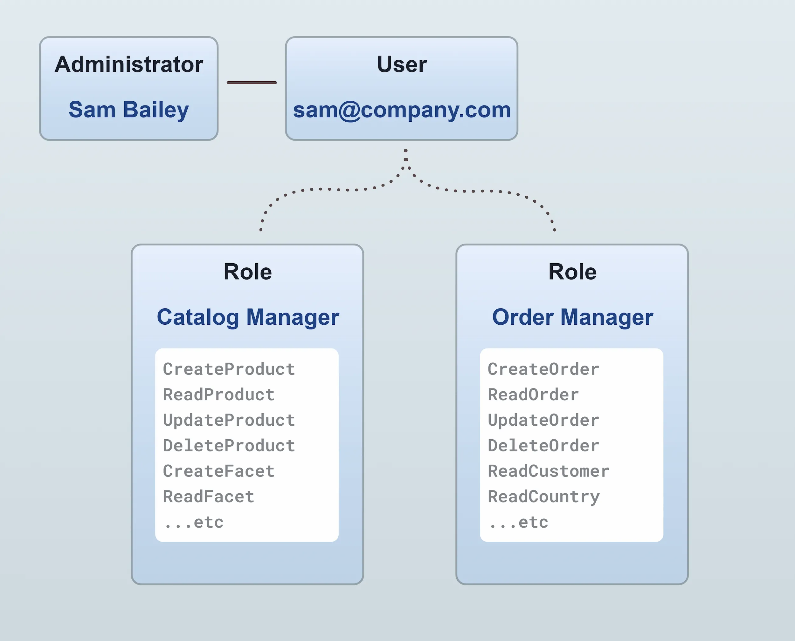
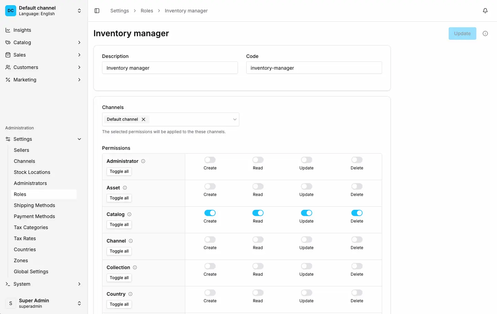

Roles are the foundation of Vendure's **role-based access control (RBAC)** system. A Role is a named
collection of [Permissions](/core-concepts/permissions/) that determines what actions an administrator
is allowed to perform.

## How roles work

Each [`Administrator`](/reference/typescript-api/entities/administrator/) is granted one or more Roles,
each on a specific Channel. When an administrator makes a request to the Admin API, Vendure checks whether
the roles they hold on the active Channel include the permission required for that operation. If not, the
request is denied.

When an administrator has multiple roles, the permissions from all roles are **unioned together**. This
means an administrator with an "Order Manager" role and a "Catalog Manager" role can perform all actions
allowed by either role.

## Built-in roles

Vendure creates two special roles automatically. These roles cannot be modified or deleted:

- **SuperAdmin** — carries every permission in the system. This role is assigned to the first
  administrator created during server initialization. It grants unrestricted access to all operations
  across all channels.

- **RoleEditor** — carries the `CreateRole`, `ReadRole`, `UpdateRole` and `DeleteRole` permissions.
  An administrator can create, edit or delete a role only when they hold RoleEditor on every Channel
  where that role is granted. It is not granted to anyone by default.

Customers do not hold a role. A registered customer gets the `Authenticated` permission on each Channel
they are a member of, which lets them manage their own account and view their order history.

## Custom roles

Beyond the built-in roles, administrators can create any number of custom roles to match their
organizational structure. A custom role is defined by selecting the specific permissions it should
grant.

Common patterns include roles like "Inventory Manager" (stock and product permissions), "Order
Processor" (order and fulfillment permissions), or "Marketing Lead" (promotion and collection
permissions). The granularity of Vendure's permission system means you can tailor roles precisely
to each team member's responsibilities.

## Roles and Channels

A role is not tied to any Channel. Instead, each grant of a role to an administrator names the Channel
it applies to. This record is a [`RoleAssignment`](/reference/typescript-api/entities/role-assignment/):
a user, a role and a Channel.

This lets multi-tenant and multi-vendor setups share one set of role definitions. For example, in a
marketplace every seller's administrator can be granted the same "Product Manager" role, each on their
own seller's Channel. They can manage products within their Channel but have no access to other
Channels or the default Channel.

An administrator can hold different roles on different Channels, and the same role on several Channels.
SuperAdmin is the exception: it is granted once and applies on every Channel, including Channels
created later.

## Role assignment

Roles are granted to administrators per Channel through the Admin API (`assignRolesToUser` and
`removeRolesFromUser`) or the admin interface. You can grant or revoke a role on a Channel only when you
hold every permission of that role on that Channel. Changes take effect
on the administrator's next authenticated request — there is no need to invalidate sessions.

## Further reading

- [Permissions](/core-concepts/permissions/) — the individual permissions that make up a role
- [User Management](/core-concepts/user-management/) — how users and administrators relate
- [Channels](/core-concepts/channels/) — channel-scoped access control for multi-tenant setups
